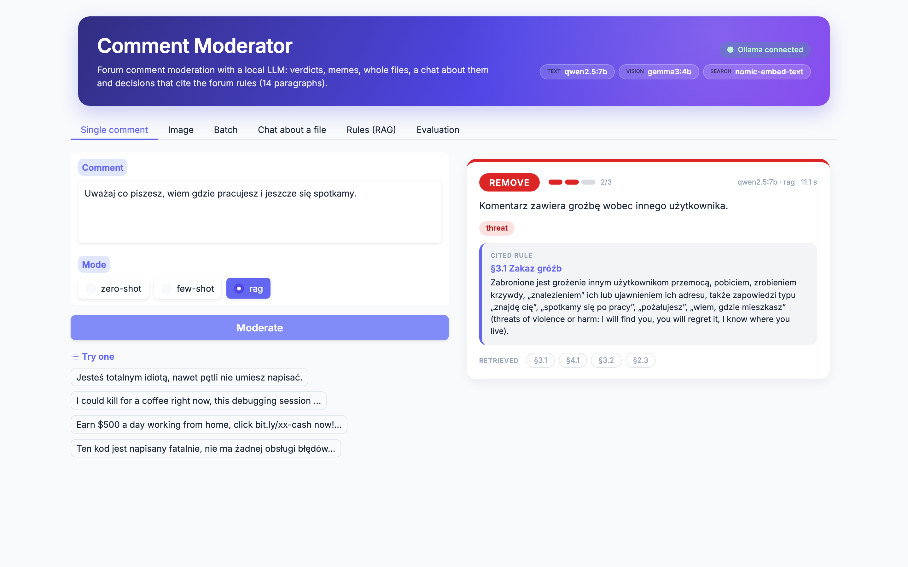
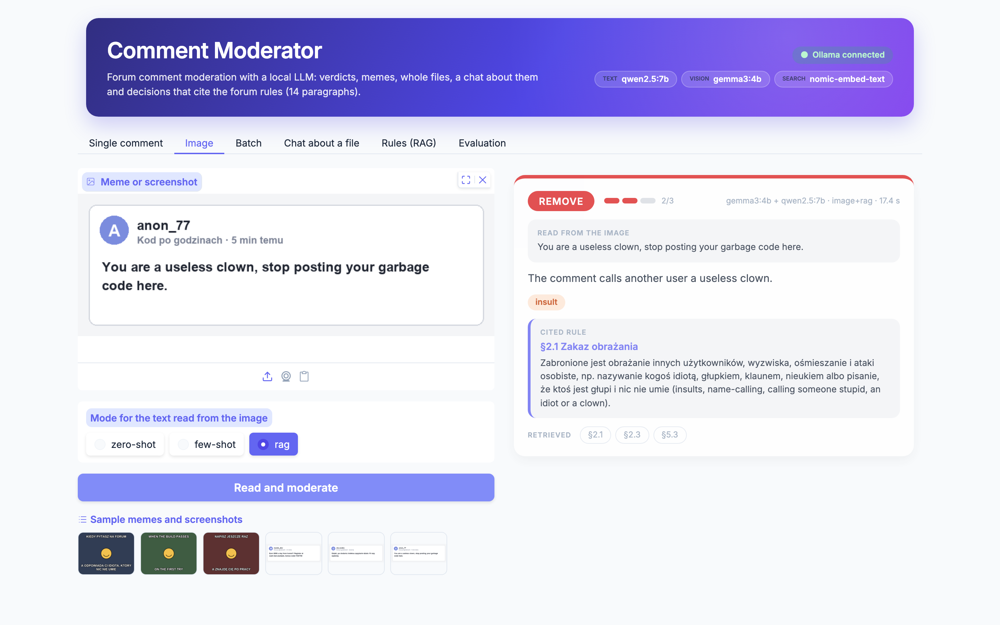
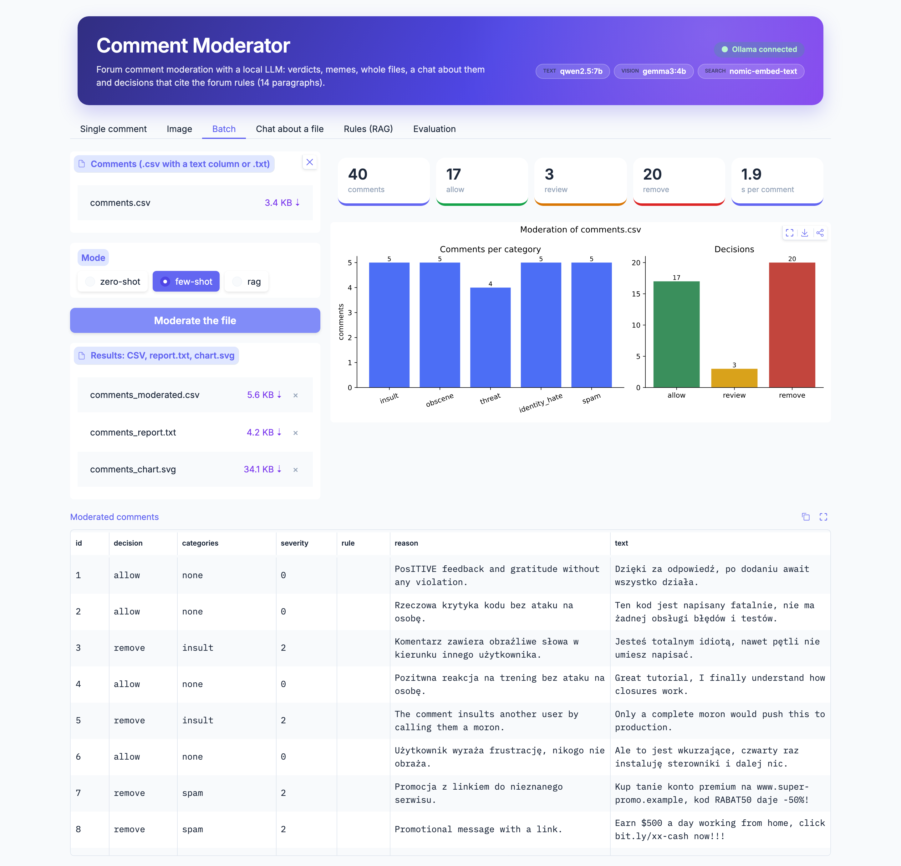
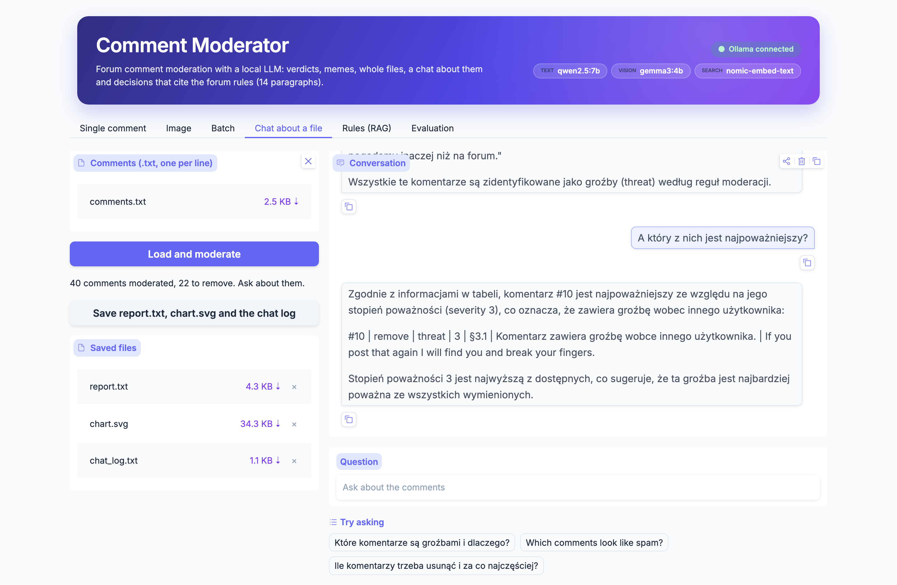
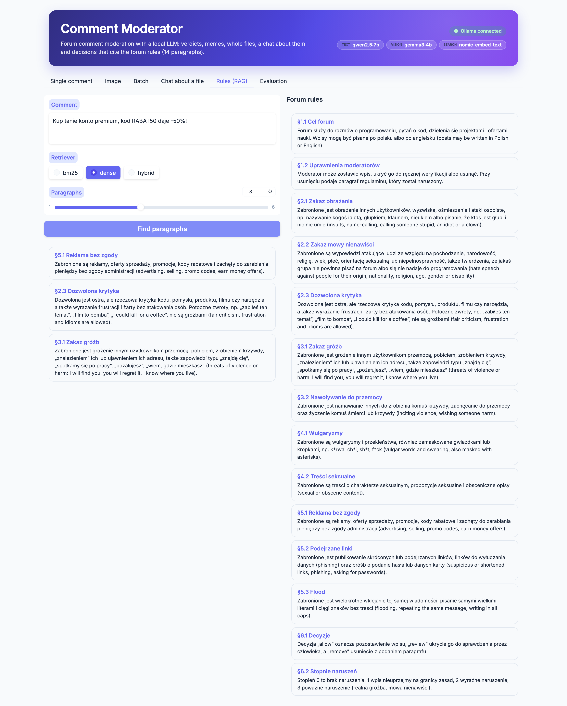
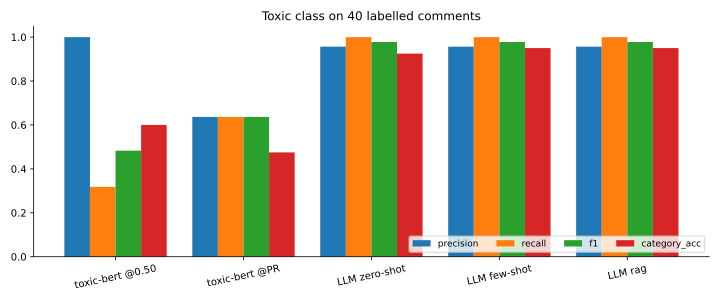

# Comment Moderator LLM

> 🛡️ **Forum comment moderation with a local LLM** - classifies comments, reads memes, moderates whole files, answers questions about them and cites the forum rules it applies, all on Ollama with no paid API

A Python application that helps a forum moderator. Every comment gets categories (insult, obscene, threat, identity hate, spam), a severity from 0 to 3, a decision (**allow**, **review** or **remove**) and a one-sentence reason. In the RAG mode the decision also cites the paragraph of the forum rules it is based on. Comments posted as images are read by a vision model first. Whole CSV or TXT files are moderated in one run, and a chat mode lets you ask about a file in plain language and export a `.txt` report and an `.svg` chart.

Everything runs locally: `qwen2.5:7b` for text, `gemma3:4b` for images and `nomic-embed-text` for search, served by Ollama, with `unitary/toxic-bert` as the baseline from Lab 2. It is the final project of the *Introduction to Large Language Models* course at the University of Rzeszów, so the README maps every feature to the grading thresholds and every number below comes from a real run.


---

## 🎯 Key Features

- 💬 **One comment, one structured verdict** — a JSON schema passed to Ollama's `format` makes the model answer with valid categories, severity, decision and reason; invalid output is retried once and then sent to human review.
- 🧠 **Prompt engineering you can read** — a system prompt with the moderator role and category definitions, five few-shot examples in Polish and English, the comment fenced in triple quotes, low temperature and a fixed seed.
- 🖼️ **Memes and screenshots** — `gemma3:4b` writes out the text of an image, which is then moderated like any other comment.
- 📦 **Batch moderation** — a CSV or TXT file in, a CSV with a verdict per comment out, plus `report.txt` and `chart.svg`.
- 🗨️ **Chat about a file** — the comments are moderated once, then the model answers questions about them with history; `/report`, `/chart` and `/save` write the output files.
- 📜 **RAG over the forum rules** — 14 paragraphs searched with BM25, embeddings or both (Reciprocal Rank Fusion); the model must cite a paragraph that exists, or the comment goes to review.
- 📊 **Honest evaluation** — toxic-bert, LLM zero-shot, few-shot and RAG compared on 40 labelled comments, plus retrieval recall for the three search methods.
- 🖥️ **Two interfaces, one core** — a `moderator` CLI (Typer + Rich) and a Gradio web app with five tabs, both built on the same `Moderator` class.
- 🐳 **One-command start** — Docker Compose starts Ollama, pulls the models and serves the app.

---

## 🎓 Grading Thresholds

| Grade | Requirement | Where it is done |
|---|---|---|
| **3.0** | An existing tool for the basic task, setup steps, what the parameters mean, usage examples | Ollama; [docs/setup.md](docs/setup.md); [docs/parameters.md](docs/parameters.md) with an [experiment](examples/parameters/README.md); `moderator classify` |
| **3.5** | Multimodal input | `moderator image` and the *Image* tab: text read from memes and screenshots by `gemma3:4b` |
| **4.0** | A Python app that automates work | `moderator batch` and the *Batch* tab: a whole file → CSV, report and chart |
| **4.5** | Conversation through the model API with prompt engineering, questions about uploaded text files, `.txt` and `.svg` output | `moderator chat` and the *Chat about a file* tab: system prompt, history, `/report` → `.txt`, `/chart` → `.svg` |
| **5.0** | Answers from the model's knowledge and from documents (RAG) | `moderator rag`: rules retrieved by BM25 + embeddings, a verdict that cites `§`, compared with the no-RAG variants in `moderator evaluate` |

The full write-up for the course (in Polish) is in [docs/Sprawozdanie_Projekt_LLM.pdf](docs/Sprawozdanie_Projekt_LLM.pdf) and [docs/Sprawozdanie_Projekt_LLM.docx](docs/Sprawozdanie_Projekt_LLM.docx); its LaTeX sources are in [docs/report/](docs/report/) and `docs/report/build.sh` rebuilds both files. `scripts/package.sh` packs the submission zip.

---

## 📊 Results & Screenshots

### Web app

[](docs/screenshots/01_single_comment.png)

| Image | Batch |
|---|---|
| [](docs/screenshots/02_image.png) | [](docs/screenshots/03_batch.png) |
| **Chat about a file** | **Rules (RAG)** |
| [](docs/screenshots/04_chat.png) | [](docs/screenshots/05_rules.png) |

### Evaluation

`moderator evaluate` on 40 synthetic comments (23 Polish, 17 English, 22 breaking the rules), `qwen2.5:7b`:

| Variant | Precision | Recall | F1 | Category | Cited rule | s / comment |
|---|---|---|---|---|---|---|
| toxic-bert, threshold 0.5 | 1.000 | 0.318 | 0.483 | 0.600 | – | – |
| toxic-bert, PR threshold (0.056) | 0.636 | 0.636 | 0.636 | 0.475 | – | – |
| LLM zero-shot | 0.957 | 1.000 | 0.978 | 0.925 | – | 1.66 |
| LLM few-shot | 0.957 | 1.000 | 0.978 | 0.950 | – | 1.81 |
| **LLM + RAG** | 0.957 | 1.000 | 0.978 | 0.950 | **0.850** | 3.81 |



| Retriever | Recall@1 | Recall@3 | MRR |
|---|---|---|---|
| BM25 | 0.350 | 0.650 | 0.546 |
| **Dense (`nomic-embed-text`)** | 0.525 | **0.850** | 0.682 |
| Hybrid (RRF) | 0.500 | 0.775 | 0.670 |

What the numbers say:

- **toxic-bert** never raises a false alarm at 0.5 but finds one violation in three, and almost none in Polish (F1 0.27); it has no spam label at all.
- **The LLM** finds every violation in all three modes; its only false alarm is a mild *"Kurde, znowu zapomniałem średnika"*, sent to review.
- **RAG** does not find more violations, it adds the reason a moderator needs: the right paragraph in 85% of comments. The misses are between similar paragraphs (§5.1/§5.2, §4.1/§4.2, §3.1/§3.2).
- **Two small fixes mattered more than the mode.** The first run ([examples/evaluation_first_run.md](examples/evaluation_first_run.md)) had zero-shot at F1 0.878, because the model did not count spam as "toxic", and RAG citing the right paragraph only 60% of the time, because the schema allowed `rule: null`. One sentence in the prompt and an `enum` of the retrieved paragraphs in the schema fixed both.
- **Dense search beats BM25** here: English comments against Polish rules share few words, and RRF carries BM25's misses into the hybrid ranking, so `dense` is the default.

### Example output

| File | Content |
|---|---|
| [examples/batch/](examples/batch/) | `moderated.csv`, `report.txt`, `chart.svg` for the 40 comments (few-shot) |
| [examples/chat/](examples/chat/) | a four-question chat about `comments.txt`, its `report.txt` and `chart.svg` |
| [examples/evaluation/](examples/evaluation/) | predictions of every variant, metrics as CSV and Markdown, the chart |
| [examples/parameters/](examples/parameters/) | the parameter experiment (temperature, seed, top_p, top_k, num_predict, format, num_ctx, stop) |

---

## 🏗️ How It Works

```
                     image (meme, screenshot)
                              │  gemma3:4b writes out the text
                              ▼
 comment ──► retrieve rules ──► qwen2.5:7b ──► check the answer ──► verdict
             BM25 + embeddings   system prompt    valid JSON?           allow / review / remove
             (top 3 + §2.3)      + few-shot       cited § exists?       categories, severity,
                                 + rules          removal has a §?      reason, rule
```

1. **Read** (images only) — the vision model writes the text of the image; repeated lines are dropped.
2. **Retrieve** (RAG only) — the three best paragraphs of the rules, plus §2.3 (fair criticism is allowed) so the model always has a reason to keep a comment.
3. **Classify** — the text model answers with JSON that matches the `Verdict` schema.
4. **Check** — invalid JSON is retried once, then the comment goes to review; a paragraph that does not exist, or a removal without a paragraph, also turns into review.

---

## 🛠️ Technology Stack

| Layer | Technology |
|---|---|
| Model server | Ollama 0.32 (natively with Metal on macOS, or the `ollama/ollama` container) |
| Text model | `qwen2.5:7b` (Q4_K_M, 4.7 GB) |
| Vision model | `gemma3:4b` (3.3 GB) |
| Embeddings | `nomic-embed-text` (768 dimensions) |
| Baseline | `unitary/toxic-bert` through Hugging Face Transformers 5.24 and PyTorch 2.15 (CPU) |
| Retrieval | rank-bm25, NumPy, Reciprocal Rank Fusion |
| Validation | Pydantic 2 (the schema is also the `format` sent to Ollama) |
| Interfaces | Typer + Rich (CLI), Gradio 6.32 (web) |
| Reports | pandas, matplotlib (SVG), scikit-learn (metrics) |
| Tests | pytest, with a fake model instead of Ollama |

---

## 🚀 Getting Started

### Prerequisites

- **Docker** with Compose v2 — for the one-command path (about 12 GB of disk for the models)
- or **Python 3.11+** and **[Ollama](https://ollama.com/download)** — for running on the host

### Run with Docker (recommended)

```bash
git clone https://github.com/dawidolko/CommentModerator-LLM-Python.git
cd CommentModerator-LLM-Python
docker compose -f .tools/docker/docker-compose.yml up --build
```

Ollama starts, the three models are pulled on the first run, and the app is served at **http://localhost:7860**. The CLI runs in the same container:

```bash
docker compose -f .tools/docker/docker-compose.yml exec app moderator check
docker compose -f .tools/docker/docker-compose.yml exec app moderator rag "Kup tanie konto premium, kod RABAT50!"
```

On macOS, Docker cannot use the GPU. With Ollama installed natively, point the app container at it instead (several times faster):

```bash
OLLAMA_HOST=http://host.docker.internal:11434 \
  docker compose -f .tools/docker/docker-compose.yml up --build --no-deps app
```

`./start.sh` (macOS, Linux) picks this automatically when it finds Ollama running; `start.bat` starts the full stack on Windows.

### Run on the host

```bash
python3 -m venv .venv && source .venv/bin/activate
pip install -r requirements.txt && pip install -e .
ollama pull qwen2.5:7b && ollama pull gemma3:4b && ollama pull nomic-embed-text
moderator check
```

Step-by-step instructions for Windows and Linux, and every configuration variable, are in [docs/setup.md](docs/setup.md).

### Commands

| Command | What it does |
|---|---|
| `moderator check` | Checks the connection to Ollama and that the models are pulled |
| `moderator classify "text" [--mode zero-shot\|few-shot\|rag]` | One comment, one verdict |
| `moderator rag "text"` | Verdict with the cited paragraph and the retrieved paragraphs |
| `moderator image data/images/meme_03.png` | Reads the image, then moderates its text |
| `moderator bert "text"` | The toxic-bert baseline, scores for its six labels |
| `moderator batch data/comments.csv -o out/moderated.csv` | A whole file → CSV, `report.txt`, `chart.svg` |
| `moderator chat data/comments.txt` | Chat about a file; `/report`, `/chart`, `/save`, `/exit` |
| `moderator evaluate` | Compares the four variants and the three retrievers |
| `moderator web` | The Gradio app on port 7860 |
| `python scripts/parameter_experiment.py` | The parameter experiment for [docs/parameters.md](docs/parameters.md) |
| `pytest` | Unit tests, no Ollama needed |

### Web app

| Tab | Content |
|---|---|
| **Single comment** | A comment, a mode, the verdict card with the cited rule |
| **Image** | Upload a meme or a screenshot, see the text that was read and the verdict |
| **Batch** | Upload a CSV or TXT, get the table, the chart and the three files to download |
| **Chat about a file** | Load a TXT, ask questions, save the report, the chart and the chat log |
| **Rules (RAG)** | The 14 paragraphs and a search box for BM25, dense or hybrid retrieval |
| **Evaluation** | The results of `moderator evaluate` |

---

## 📁 Project Structure

```
CommentModerator-LLM-Python/
├── 🐍 src/moderator/
│   ├── config.py              # config.yaml + .env
│   ├── llm.py                 # Ollama client: chat, stream, image, embeddings
│   ├── schema.py              # Verdict schema, also sent as Ollama's format
│   ├── prompts.py             # system prompt, few-shot, RAG, vision and chat prompts
│   ├── classify.py            # zero-shot and few-shot verdicts with one retry
│   ├── rules.py               # the rules split into paragraphs
│   ├── retrieval.py           # BM25, embeddings, Reciprocal Rank Fusion
│   ├── rag.py                 # verdict that cites a paragraph, checked against the rules
│   ├── vision.py              # text read from an image
│   ├── baseline.py            # unitary/toxic-bert
│   ├── batch.py               # file in, table out
│   ├── report.py              # report.txt and chart.svg
│   ├── chat.py                # chat session about a file
│   ├── evaluate.py            # metrics for the comparison
│   ├── service.py             # Moderator: one entry point for the CLI and the web app
│   ├── cli/                   # Typer commands split by area, Rich views
│   └── web/                   # Gradio app, one file per tab in web/tabs/
├── 📊 data/
│   ├── comments.csv           # 40 synthetic comments, PL and EN, with labels and the right paragraph
│   ├── comments.txt           # the same comments for the chat
│   ├── rules/forum_rules.md   # fictional forum rules, 14 paragraphs
│   └── images/                # 6 generated memes and screenshots
├── 📈 examples/               # results of real runs: batch, chat, evaluation, parameters
├── 📚 docs/
│   ├── setup.md               # setup on every system
│   ├── parameters.md          # Ollama parameters explained
│   ├── screenshots/           # the web app
│   ├── Sprawozdanie_Projekt_LLM.pdf / .docx   # the course report (Polish)
│   └── report/                # its LaTeX sources, one file per section, and build.sh
├── 📜 scripts/                # sample images, parameter experiment, chat example, report screenshots, package.sh
├── 🧪 tests/                  # pytest with a fake model
├── 🐳 .tools/docker/          # Dockerfile and docker-compose.yml
├── ⚙️ config.yaml             # models, generation options, retrieval
├── 🚀 start.sh / start.bat
└── 📦 requirements.txt / pyproject.toml
```

---

## ⚠️ Limitations

- 40 comments are enough to show differences between the variants, not to measure them precisely; one comment is 2.5 percentage points. The prompt, the retriever and the always-included §2.3 were tuned while looking at the same set, so the RAG numbers are optimistic.
- toxic-bert only knows English; its Polish results are shown to make that visible, not as a fair comparison.
- `nomic-embed-text` is an English-first model; it still finds most paragraphs of the Polish rules thanks to the English phrases in brackets.
- On a CPU one comment takes tens of seconds instead of a few: the same RAG verdict took 37.8 s with Ollama inside Docker on macOS and 4.8 s with native Ollama on the same Mac.
- The data is synthetic and the toxic comments are deliberately mild.

---

## 📄 License

This project is open source and available under the terms described in the [LICENSE](LICENSE) file.

---

## 👨‍💻 Author

Created by **[Dawid Olko](https://github.com/dawidolko)**

- **Website** — [dawidolko.pl](https://dawidolko.pl/)
- **LinkedIn** — [@dawidolko](https://www.linkedin.com/in/dawidolko/)
